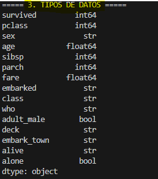

# 🕵️‍♂️ Práctica: Identificación de Problemas en los Datos

> **⏱️ Duración:** 2 horas  
> **🎯 Nivel:** Cero a principiante  
> **🤖 Área:** Machine Learning (Data Cleaning)  
> **💻 Herramientas:** Python, VS Code, Pandas, NumPy, Seaborn  
## Caleb Dorado NC = 0039 UNIDAD 3 Grupo 3-H
---

## 🎯 Propósito de la Práctica
Que los estudiantes aprendan a revisar conjuntos de datos (*datasets*) e identifiquen los problemas más comunes que pueden arruinar el entrenamiento de un modelo de Machine Learning.

# CASO 1: PASAJEROS DEL TITANIC
# Caleb Dorado NC = 0039 Grupo 3-H UNIDAD 3

## Vista previa de Datos

## Tipos de Datos

## Datos nulos y su porcentaje